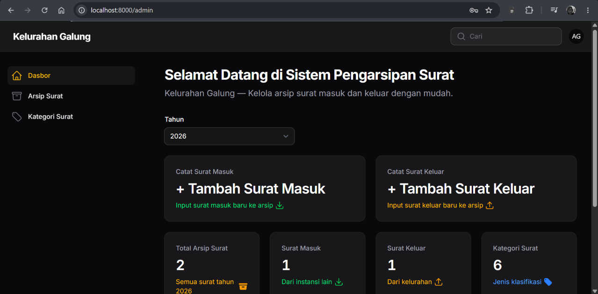
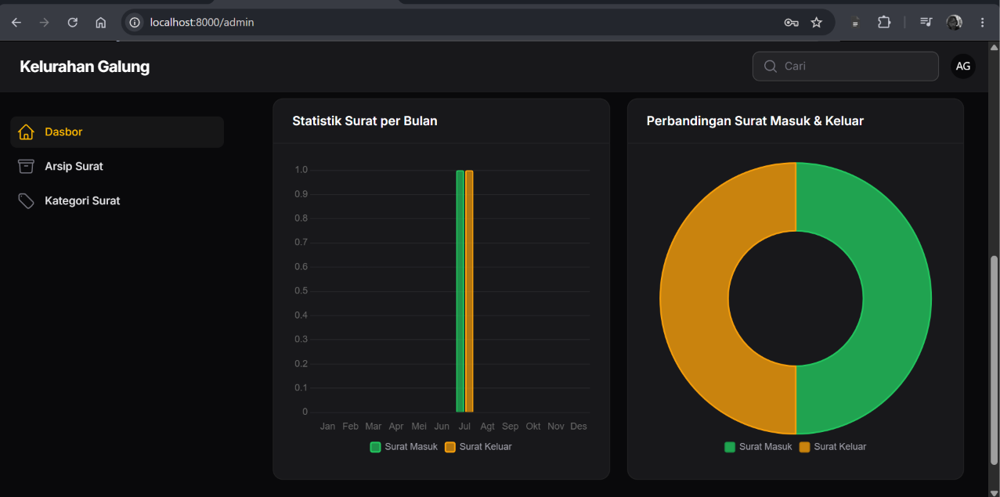
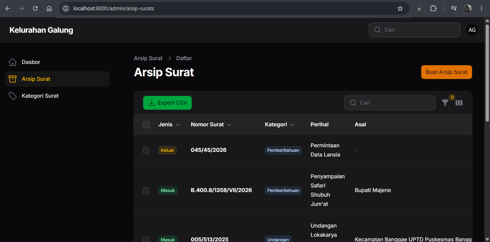
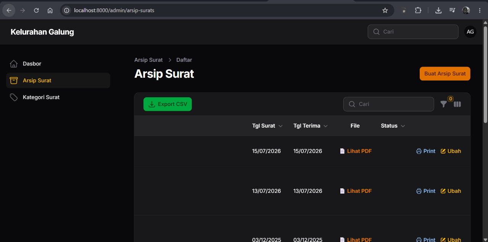

# 📁 Sistem Informasi Kearsipan Berbasis Web — Kelurahan Galung

A web-based digital archiving system engineered to replace manual paper-based tracking at Kelurahan Galung. This system transforms inefficient administrative workflows into a secure, centralized, and data-driven ecosystem.

## 🚀 Impact & Results
*   **Massive Efficiency Gain:** Reduced document retrieval time from **30 minutes to under 3 seconds** using indexed database queries and dynamic search filters.
*   **100% Test Passed:** Successfully passed 26 Black-Box test cases (after fixing 2 critical bugs in the first round).
*   **Data Integrity:** Implemented Audit Trail and Soft Delete features to prevent data loss and ensure absolute accountability.

## 🛠️ Tech Stack
- **Backend:** PHP 8.3, Laravel 13
- **Admin Panel:** Filament 5
- **Database:** MySQL
- **Frontend Styling:** Tailwind CSS
- **Testing:** Black-Box Testing (Quality Assurance)

## ✨ Core Features
- 🔐 **Authentication:** Secure admin login with session-based authentication.
- 📊 **Analytics Dashboard:** Interactive charts and statistics for incoming/outgoing mail.
- 🔢 **Auto-Generate Numbering:** Automated letter numbering to eliminate human error (duplicate numbers).
- ♻️ **Recycle Bin (Soft Delete):** Safe deletion with data recovery (restore) capabilities.
- 🕵️ **Audit Trail:** Read-only activity logs (powered by Spatie ActivityLog) for absolute traceability.
- 📎 **File Management:** Upload, download (PDF), and print-ready letterheads.
- 📤 **Data Export:** Export archive data to CSV format.

## 🧑‍💻 My Role in this Project
**Web Developer & System Testing Specialist**
- Designed the database schema (ERD) and developed the full-stack features using Laravel & Filament.
- Conducted rigorous Black-Box Testing across 8 modules (26 test cases). Identified and fixed critical cascade-delete vulnerabilities and duplicate validation bugs, achieving a 100% success rate upon regression testing.

## 📸 Screenshots

### 1. Tampilan Dashboard Analitik



### 2. Tampilan Manajemen Arsip Surat




## ⚙️ How to Install (Local Development)

```bash
git clone https://github.com/Plida05/Project-Capstone-Arsip-Surat-Kel-Galung.git arsip_surat
cd arsip_surat
composer install
cp .env.example .env
php artisan key:generate
# Setup database in .env
php artisan migrate --seed
php artisan storage:link
php artisan serve

Buka: http://localhost:8000/admin

Login Default:

Email: admin@galung.test

Password: password123


---

### 💡 Langkah Terakhir (Opsional tapi Penting)
Di dalam repo Capstone-mu, coba klik **About** (ikon gerigi di sebelah kanan atas halaman repo).
1. Tambahkan **Description**: *"Web-based digital archiving system for Kelurahan Galung built with Laravel & Filament."*
2. Tambahkan **Topics**: `laravel`, `filament`, `mysql`, `web-development`, `capstone-project`.

Kalau semua ini udah kamu *commit*, profil GitHub dan repo Capstone-mu bakal kelihatan **super profesional**. 

Silakan dieksekusi, dan kabarin kalau udah beres atau kalau ada yang *error*! 🚀
